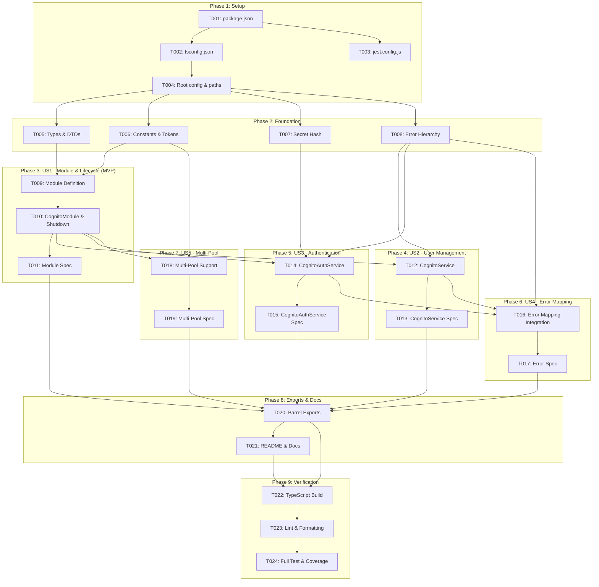

# Tasks: AWS Integration Library with Cognito User Pools (libs-aws)

**Input**: Design documents from `/specs/009-libs-aws-cognito/` (`spec.md`, `plan.md`, `research.md`, `data-model.md`, `contracts/`, `quickstart.md`)  
**Prerequisites**: `plan.md`, `spec.md`, `research.md`, `data-model.md`, `contracts/`  
**Branch**: `009-libs-aws-cognito`

---

## Task Organization & Format

Tasks are organized by phase and mapped to user stories (`[US1]` through `[US5]`) to ensure modularity, independent testing, and incremental delivery.

Format: `- [ ] [TaskID] [P?] [Story?] Description with file path`
- **[P]**: Parallelizable (touches independent files and has no unmet task dependencies)
- **[Story]**: Mapped user story (`[US1]` to `[US5]`)
- Every task includes target files, expected implementation behavior, dependencies, acceptance criteria, and required tests.

---

## Phase 1: Repository Inspection and Library Setup (Shared Infrastructure)

**Purpose**: Initialize package configuration, build scripts, TypeScript settings, and test environment for `@new-hros/libs-aws` within the monorepo workspace.

- [X] T001 Initialize package manifest and dependencies in `libs/libs-aws/package.json`
  - **Target File**: `libs/libs-aws/package.json`
  - **Behavior**: Create the package manifest for `@new-hros/libs-aws` v1.0.0 with dependencies `@nestjs/common` (^10.0.0), `@nestjs/core` (^10.0.0), `@aws-sdk/client-cognito-identity-provider` (^3.500.0), `rxjs` (^7.8.1), and devDependencies `@types/jest`, `jest`, `ts-jest`, `@nestjs/testing`, `typescript`.
  - **Dependencies**: None
  - **Acceptance Criteria**: Package manifest is valid JSON and npm recognizes the workspace.
  - **Required Tests**: Verified by running `npm run build` / workspace resolution.

- [X] T002 [P] Configure TypeScript compiler settings in `libs/libs-aws/tsconfig.json` and `libs/libs-aws/tsconfig.lib.json`
  - **Target Files**: `libs/libs-aws/tsconfig.json`, `libs/libs-aws/tsconfig.lib.json`
  - **Behavior**: Configure TypeScript with `target: es2022`, `module: commonjs`, `declaration: true`, and strict options (`strictNullChecks: true`, `noImplicitAny: true`, `strictBindCallApply: true`).
  - **Dependencies**: None
  - **Acceptance Criteria**: `tsc --noEmit` runs successfully in `libs/libs-aws`.
  - **Required Tests**: TypeScript compilation check.

- [X] T003 [P] Configure Jest test runner in `libs/libs-aws/jest.config.js`
  - **Target File**: `libs/libs-aws/jest.config.js`
  - **Behavior**: Configure Jest with `ts-jest` preset, `testRegex: '.*\\.spec\\.ts$'`, `testEnvironment: 'node'`, and code coverage thresholds (`collectCoverageFrom: ['src/**/*.ts', '!src/**/index.ts']`).
  - **Dependencies**: None
  - **Acceptance Criteria**: Jest test runner discovers test files and executes without configuration errors.
  - **Required Tests**: `npm test -w @new-hros/libs-aws` executes Jest runner.

- [X] T004 Register workspace path mappings and build scripts in root `tsconfig.json` and root `package.json`
  - **Target Files**: `tsconfig.json`, `package.json`
  - **Behavior**: Add `"@new-hros/libs-aws": ["libs/libs-aws/src"]` to root `tsconfig.json` paths and append `@new-hros/libs-aws` build to root `package.json` scripts.
  - **Dependencies**: T001, T002
  - **Acceptance Criteria**: Consuming workspaces can resolve `@new-hros/libs-aws` import path.
  - **Required Tests**: Monorepo build and path resolution check.

---

## Phase 2: Foundational Types, Constants, Secret Hash, and Error Hierarchy

**Purpose**: Core types, cryptographic helpers, constants, and framework-agnostic error mapping classes that all subsequent services and modules depend on.

- [X] T005 [P] Implement Cognito configuration, entity, and DTO types in `libs/libs-aws/src/cognito/cognito.types.ts`
  - **Target File**: `libs/libs-aws/src/cognito/cognito.types.ts`
  - **Behavior**: Define `CognitoModuleOptions`, `CognitoModuleAsyncOptions`, `CognitoUserRecord`, `CognitoUserStatus`, `PaginatedUserList`, `CognitoTokens`, `CognitoChallenge`, `CognitoAuthResult`, and input interfaces conforming to `specs/009-libs-aws-cognito/data-model.md`.
  - **Dependencies**: T001
  - **Acceptance Criteria**: Types compile with zero TypeScript warnings under `strict: true`.
  - **Required Tests**: Type contract compilation.

- [X] T006 [P] Implement dependency injection tokens and helper functions in `libs/libs-aws/src/cognito/cognito.constants.ts`
  - **Target File**: `libs/libs-aws/src/cognito/cognito.constants.ts`
  - **Behavior**: Define `COGNITO_MODULE_OPTIONS`, `COGNITO_CLIENT`, and dynamic token generator functions: `getCognitoClientToken(name?)`, `getCognitoServiceToken(name?)`, `getCognitoAuthServiceToken(name?)`, `getCognitoOptionsToken(name?)`.
  - **Dependencies**: T001
  - **Acceptance Criteria**: Helper functions return standard tokens when name is undefined, and distinct namespaced tokens when `name` is provided.
  - **Required Tests**: Token resolution tests.

- [X] T007 [P] Implement HMAC-SHA256 client secret hash calculation in `libs/libs-aws/src/cognito/cognito-secret-hash.ts`
  - **Target File**: `libs/libs-aws/src/cognito/cognito-secret-hash.ts`
  - **Behavior**: Implement `computeSecretHash(username: string, clientId: string, clientSecret: string): string` using Node.js `node:crypto` `createHmac('sha256', clientSecret).update(username + clientId).digest('base64')`.
  - **Dependencies**: T001
  - **Acceptance Criteria**: Correctly computes standard AWS Cognito HMAC-SHA256 Base64 hash; handles empty inputs safely without throwing unhandled exceptions.
  - **Required Tests**: Unit tests in secret hash test suite verifying known test vector vectors.

- [X] T008 [P] Implement domain error hierarchy and error mapper in `libs/libs-aws/src/cognito/cognito.errors.ts`
  - **Target File**: `libs/libs-aws/src/cognito/cognito.errors.ts`
  - **Behavior**: Implement base `CognitoException` and subclasses (`CognitoUserNotFoundException`, `CognitoUserAlreadyExistsException`, `CognitoNotAuthorizedException`, `CognitoInvalidPasswordException`, `CognitoCodeMismatchException`, `CognitoCodeExpiredException`, `CognitoPasswordResetRequiredException`, `CognitoUserNotConfirmedException`, `CognitoInternalException`). Implement `CognitoErrorMapper.map(error, fallbackMessage?)` preserving original `cause`.
  - **Dependencies**: T001
  - **Acceptance Criteria**: Domain errors extend `Error`, contain `code` and `cause`, and do not import or depend on `@nestjs/common` HTTP exceptions.
  - **Required Tests**: Unit tests verifying mapping from AWS SDK error types to domain errors.

---

## Phase 3: User Story 1 - CognitoModule Dynamic Registration & Client Lifecycle (Priority: P1) 🎯 MVP

**Goal**: Enable consuming applications to configure and import `CognitoModule` synchronously (`forRoot`) and asynchronously (`forRootAsync`), injecting a shared `CognitoIdentityProviderClient` supporting default credentials or custom options, and destroying the client on application shutdown.

**Independent Test**: Can be tested by creating a testing module with `CognitoModule.forRoot(...)` and `CognitoModule.forRootAsync(...)`, verifying that client and options are resolved correctly, and calling `app.close()` to ensure `client.destroy()` is executed.

- [X] T009 [P] [US1] Create configurable module definition in `libs/libs-aws/src/cognito/cognito.module-definition.ts`
  - **Target File**: `libs/libs-aws/src/cognito/cognito.module-definition.ts`
  - **Behavior**: Create `ConfigurableModuleBuilder<CognitoModuleOptions>` with `.setClassPrefix('Cognito')` and `.build()`, exporting `ConfigurableModuleClass`, `MODULE_OPTIONS_TOKEN`, `ASYNC_OPTIONS_TYPE`, and `OPTIONS_TYPE`.
  - **Dependencies**: T005, T006
  - **Acceptance Criteria**: Builder exports standard NestJS configurable module classes and tokens.
  - **Required Tests**: Module compilation and DI resolution.

- [X] T010 [US1] Implement `CognitoModule` with `forRoot()`, `forRootAsync()`, and `OnApplicationShutdown` in `libs/libs-aws/src/cognito/cognito.module.ts`
  - **Target File**: `libs/libs-aws/src/cognito/cognito.module.ts`
  - **Behavior**: Implement dynamic module methods `forRoot(options)` and `forRootAsync(options)`. Provide `CognitoIdentityProviderClient` factory using the default AWS SDK credential provider chain when credentials are not supplied, or custom options if supplied. Implement `OnApplicationShutdown` to invoke `client.destroy()`. Register and export `CognitoService`, `CognitoAuthService`, and client provider.
  - **Dependencies**: T005, T006, T009
  - **Acceptance Criteria**: Synchronous and asynchronous imports successfully provide all Cognito services and client; client `.destroy()` is called on module shutdown.
  - **Required Tests**: Unit tests in `cognito.module.spec.ts`.

- [X] T011 [P] [US1] Unit test module initialization, async options, and client lifecycle in `libs/libs-aws/src/cognito/cognito.module.spec.ts`
  - **Target File**: `libs/libs-aws/src/cognito/cognito.module.spec.ts`
  - **Behavior**: Test synchronous `forRoot()`, test `forRootAsync()` with `useFactory`, test default credentials vs explicit credentials, and verify `onApplicationShutdown` invokes `client.destroy()`.
  - **Dependencies**: T010
  - **Acceptance Criteria**: 100% of lifecycle and module tests pass with mock AWS client.
  - **Required Tests**: `npm test -w @new-hros/libs-aws -- cognito.module.spec.ts`.

---

## Phase 4: User Story 2 - Administrative User Pool Management (`CognitoService`) (Priority: P1)

**Goal**: Provide a type-safe `CognitoService` wrapping AWS SDK v3 administrative commands (`createUser`, `getUser`, `listUsers`, `updateUser`, `deleteUser`, `enableUser`, `disableUser`, `setUserPassword`, `adminSignOut`), automatically and immutably binding the configured `userPoolId`.

**Independent Test**: Can be tested by invoking each method of `CognitoService` against a mock `CognitoIdentityProviderClient`, asserting that the appropriate command was dispatched with the correct `UserPoolId` and mapped parameters.

- [X] T012 [US2] Implement administrative user operations in `libs/libs-aws/src/cognito/cognito.service.ts`
  - **Target File**: `libs/libs-aws/src/cognito/cognito.service.ts`
  - **Behavior**: Implement `ICognitoService` methods using AWS SDK v3 commands (`AdminCreateUserCommand`, `AdminGetUserCommand`, `ListUsersCommand`, `AdminUpdateUserAttributesCommand`, `AdminDeleteUserCommand`, `AdminEnableUserCommand`, `AdminDisableUserCommand`, `AdminSetUserPasswordCommand`, `AdminUserGlobalSignOutCommand`). Automatically bind `options.userPoolId` and prevent caller override. Normalize attribute arrays to key-value maps. Translate AWS exceptions using `CognitoErrorMapper`.
  - **Dependencies**: T005, T006, T008
  - **Acceptance Criteria**: All 9 administrative operations execute accurately; `UserPoolId` cannot be overridden; attribute conversion produces clean `CognitoUserRecord`.
  - **Required Tests**: Unit tests in `cognito.service.spec.ts`.

- [X] T013 [P] [US2] Unit test administrative user operations in `libs/libs-aws/src/cognito/cognito.service.spec.ts`
  - **Target File**: `libs/libs-aws/src/cognito/cognito.service.spec.ts`
  - **Behavior**: Mock `CognitoIdentityProviderClient.send` and verify commands for `createUser`, `getUser`, `listUsers` (with/without pagination tokens), `updateUser`, `deleteUser`, `enableUser`, `disableUser`, `setUserPassword`, and `adminSignOut`. Verify error translation on AWS failures.
  - **Dependencies**: T012
  - **Acceptance Criteria**: All test cases pass with 100% assertion coverage across user CRUD and pagination branches.
  - **Required Tests**: `npm test -w @new-hros/libs-aws -- cognito.service.spec.ts`.

---

## Phase 5: User Story 3 - Client Authentication & Challenge Handling (`CognitoAuthService`) (Priority: P1)

**Goal**: Provide `CognitoAuthService` supporting end-user authentication flows (`signUp`, `confirmSignUp`, `signIn`, `refreshToken`, `respondToChallenge`, `forgotPassword`, `confirmForgotPassword`, `changePassword`, `signOut`), automatic HMAC-SHA256 secret hash generation, and challenge preservation without logging secrets.

**Independent Test**: Can be tested by invoking `signIn` with credentials against a mock client and verifying token responses or challenge objects (`NEW_PASSWORD_REQUIRED`, MFA), verifying `SECRET_HASH` attachment when a client secret is configured, and verifying `refreshToken` rotation.

- [X] T014 [US3] Implement client authentication flows and challenge responses in `libs/libs-aws/src/cognito/cognito-auth.service.ts`
  - **Target File**: `libs/libs-aws/src/cognito/cognito-auth.service.ts`
  - **Behavior**: Implement `ICognitoAuthService` methods using AWS SDK v3 commands (`SignUpCommand`, `ConfirmSignUpCommand`, `InitiateAuthCommand`, `RespondToAuthChallengeCommand`, `ForgotPasswordCommand`, `ConfirmForgotPasswordCommand`, `ChangePasswordCommand`, `GlobalSignOutCommand`). Compute `SECRET_HASH` via `computeSecretHash` if `clientSecret` is configured. Discriminate `CognitoAuthResult` into tokens or challenge. Never log passwords, tokens, or secrets.
  - **Dependencies**: T005, T006, T007, T008
  - **Acceptance Criteria**: Auth flows successfully dispatch commands with `SECRET_HASH`; challenges are preserved; refresh tokens trigger `REFRESH_TOKEN_AUTH`; credentials are sanitized.
  - **Required Tests**: Unit tests in `cognito-auth.service.spec.ts`.

- [X] T015 [P] [US3] Unit test authentication flows, challenges, and secret hash generation in `libs/libs-aws/src/cognito/cognito-auth.service.spec.ts`
  - **Target File**: `libs/libs-aws/src/cognito/cognito-auth.service.spec.ts`
  - **Behavior**: Test `signIn` returning tokens, `signIn` returning `NEW_PASSWORD_REQUIRED` and `SMS_MFA` challenges, `respondToChallenge`, `refreshToken`, `signUp`, `confirmSignUp`, `forgotPassword`, `confirmForgotPassword`, `changePassword`, `signOut`, `SECRET_HASH` presence for secret clients and absence for secretless clients, and ensure error handling maps AWS errors cleanly.
  - **Dependencies**: T014
  - **Acceptance Criteria**: 100% of authentication paths, challenge scenarios, and secret hash permutations pass.
  - **Required Tests**: `npm test -w @new-hros/libs-aws -- cognito-auth.service.spec.ts`.

---

## Phase 6: User Story 4 - Framework-Agnostic Centralized Error Mapping (Priority: P2)

**Goal**: Ensure AWS SDK Cognito exceptions are mapped into typed domain exceptions (`CognitoUserNotFoundException`, `CognitoNotAuthorizedException`, etc.) preserving root cause while hiding sensitive AWS error internals, without coupling to NestJS HTTP exceptions.

**Independent Test**: Simulate various AWS SDK exceptions and verify that `CognitoErrorMapper` emits the corresponding typed exception with the original error accessible in `.cause` and without HTTP status code dependencies.

- [X] T016 [US4] Implement comprehensive AWS Cognito exception mapping in `libs/libs-aws/src/cognito/cognito.errors.ts`
  - **Target File**: `libs/libs-aws/src/cognito/cognito.errors.ts`
  - **Behavior**: Map AWS errors by `name` or `__type`: `UserNotFoundException` -> `CognitoUserNotFoundException`, `UsernameExistsException` -> `CognitoUserAlreadyExistsException`, `NotAuthorizedException` -> `CognitoNotAuthorizedException`, `InvalidPasswordException` -> `CognitoInvalidPasswordException`, `CodeMismatchException` -> `CognitoCodeMismatchException`, `ExpiredCodeException` -> `CognitoCodeExpiredException`, `PasswordResetRequiredException` -> `CognitoPasswordResetRequiredException`, `UserNotConfirmedException` -> `CognitoUserNotConfirmedException`, and fallback -> `CognitoInternalException`. Preserve original error in `cause`.
  - **Dependencies**: T008
  - **Acceptance Criteria**: All known AWS Cognito exceptions are mapped to distinct subclasses of `CognitoException` with sanitized messages and preserved causes.
  - **Required Tests**: Unit tests in `cognito.errors.spec.ts`.

- [X] T017 [P] [US4] Unit test exception mapping and cause preservation in `libs/libs-aws/src/cognito/cognito.errors.spec.ts`
  - **Target File**: `libs/libs-aws/src/cognito/cognito.errors.spec.ts`
  - **Behavior**: Test mapping for each AWS error type; test unknown/generic errors; verify `cause` is retained; verify no `@nestjs/common` `HttpException` dependencies exist in error prototypes.
  - **Dependencies**: T016
  - **Acceptance Criteria**: All mapping assertions pass with 100% branch coverage of error cases.
  - **Required Tests**: `npm test -w @new-hros/libs-aws -- cognito.errors.spec.ts`.

---

## Phase 7: User Story 5 - Multi-Pool Isolation & Extensibility (Priority: P3)

**Goal**: Support multiple distinct Cognito User Pool configurations within a single NestJS application using custom instance names and injection tokens without provider collisions.

**Independent Test**: Register two `CognitoModule` instances (e.g. `'AdminPool'` and `'CustomerPool'`) in a single test module and verify that services and clients for both pools can be injected and used concurrently without collision.

- [X] T018 [US5] Implement multi-pool instance naming and token resolution in `libs/libs-aws/src/cognito/cognito.module.ts`
  - **Target File**: `libs/libs-aws/src/cognito/cognito.module.ts`
  - **Behavior**: Support `options.instanceName` in `forRoot` and `forRootAsync`. If `instanceName` is provided, register providers under custom tokens from `getCognitoClientToken(name)`, `getCognitoServiceToken(name)`, and `getCognitoAuthServiceToken(name)`.
  - **Dependencies**: T006, T010
  - **Acceptance Criteria**: Multiple module configurations produce isolated provider tokens without collision.
  - **Required Tests**: Unit tests in `cognito-multi-pool.spec.ts`.

- [X] T019 [P] [US5] Unit test multi-pool coexistence in `libs/libs-aws/src/cognito/cognito-multi-pool.spec.ts`
  - **Target File**: `libs/libs-aws/src/cognito/cognito-multi-pool.spec.ts`
  - **Behavior**: Instantiate two `CognitoModule` imports in a test module with different instance names and configurations. Verify both `CognitoService` and `CognitoAuthService` instances operate on their respective pools independently.
  - **Dependencies**: T018
  - **Acceptance Criteria**: Both pool instances resolve their respective configurations and dispatches without interference.
  - **Required Tests**: `npm test -w @new-hros/libs-aws -- cognito-multi-pool.spec.ts`.

---

## Phase 8: Public API Exports & Documentation

**Purpose**: Expose a clean, organized public API through library barrel files and document installation, setup, IAM permissions, and integration guides.

- [X] T020 [P] Implement barrel exports in `libs/libs-aws/src/cognito/index.ts` and `libs/libs-aws/src/index.ts`
  - **Target Files**: `libs/libs-aws/src/cognito/index.ts`, `libs/libs-aws/src/index.ts`
  - **Behavior**: Export all public modules, services, types, constants, errors, and utility functions through clean named exports.
  - **Dependencies**: T010, T012, T014, T016, T018
  - **Acceptance Criteria**: Consuming applications can import all public symbols from `@new-hros/libs-aws`.
  - **Required Tests**: TypeScript import resolution check.

- [X] T021 [P] Author documentation and integration guide in `libs/libs-aws/README.md`
  - **Target File**: `libs/libs-aws/README.md`
  - **Behavior**: Document installation, environment variables, `forRoot` and `forRootAsync` usage, injecting `CognitoService` and `CognitoAuthService`, challenge handling, IAM policy requirements, security considerations, and unit testing instructions.
  - **Dependencies**: T020
  - **Acceptance Criteria**: README is comprehensive, accurate, and includes working code examples.
  - **Required Tests**: Markdown review and link validation.

---

## Phase 9: Build, Lint, Type-Check & Monorepo Validation

**Purpose**: Ensure the entire monorepo builds cleanly, passes all linter and TypeScript checks, and has no regressions.

- [X] T022 Execute TypeScript type check and build across `@new-hros/libs-aws`
  - **Target Files**: `libs/libs-aws/`
  - **Behavior**: Run `npm run build -w @new-hros/libs-aws` and `tsc --noEmit`.
  - **Dependencies**: T020
  - **Acceptance Criteria**: Zero compilation or type errors under `strict: true`.
  - **Required Tests**: Build execution.

- [X] T023 Run ESLint and Prettier validation on `libs/libs-aws`
  - **Target Files**: `libs/libs-aws/`
  - **Behavior**: Run linter across `libs/libs-aws/src` and `libs/libs-aws/tests`.
  - **Dependencies**: T020
  - **Acceptance Criteria**: Zero lint errors or style violations.
  - **Required Tests**: Lint check execution.

- [X] T024 Run complete test suite and verify test coverage thresholds
  - **Target Files**: `libs/libs-aws/`
  - **Behavior**: Run `npm test -w @new-hros/libs-aws -- --coverage`.
  - **Dependencies**: T011, T013, T015, T017, T019
  - **Acceptance Criteria**: 100% of unit tests pass with >= 90% statement and branch coverage. Zero real AWS network calls or credentials required.
  - **Required Tests**: Jest coverage report.

---

## Dependency Graph & Implementation Order

---

## Parallel Execution Opportunities

- **Setup & Foundation**:
  - `T002` (tsconfig) and `T003` (jest.config) can run in parallel.
  - `T005` (types), `T006` (constants), `T007` (secret hash), and `T008` (errors) can run in parallel once `T004` completes.
- **Service Implementations**:
  - `T012` (`CognitoService`) and `T014` (`CognitoAuthService`) can be implemented in parallel once `T010` is complete.
  - `T013` (CognitoService spec) and `T015` (CognitoAuthService spec) can run in parallel.
- **Documentation & Verification**:
  - `T020` (barrel exports) and `T021` (README) can be developed concurrently.
